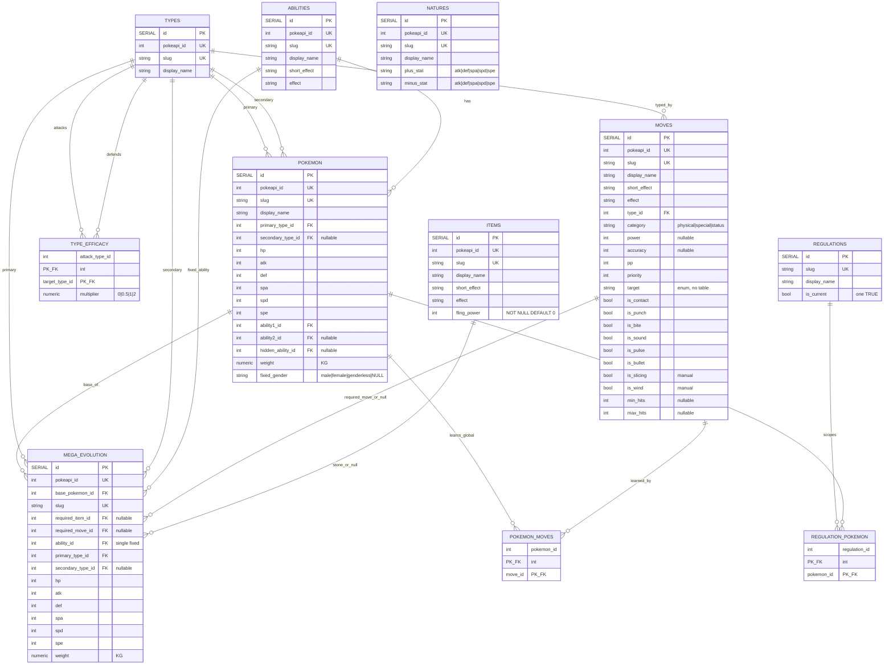

# Relational model — VGC Champions (simplified, stack-agnostic)

Scope: VGC doubles, Pokémon Champions ruleset, Mega Evolution as the only gimmick.
No Tera / Dynamax / Z-Moves / Stellar. Cosmetic forms collapsed.
Source of truth for behavior: `AGENTS.md`. Background: `reference-reports/`.
Seed data: PokeAPI CSVs (`pokemon.csv`, `pokemon_stats.csv`, `pokemon_types.csv`,
`pokemon_abilities.csv`, `pokemon_forms.csv`, `items.csv`, `moves.csv`).
EN text = `language_id 9` everywhere. Mermaid diagram at the bottom is
structural only (no sources there).

## Decisions locked so far

1. **No `species` table for now.** Each battle-distinct variant is an independent
   row. `arcanine` and `arcanine-hisui` are unrelated for calc purposes.
   (Species Clause / Pokédex sorting deferred.)
2. **Collapse cosmetics.** One row per battle-distinct variant only.
   `floette` (all 5 colors) = 1 row, `floette-eternal` = 1 row.
3. **Gender variants are separate rows** with a lock column (see `fixed_gender`).
4. **Megas (and primal reversions) live in their own table**, linked to base.
   Base table holds only non-transformation forms (e.g. `charizard`, never
   `charizard-mega-x` or `kyogre-primal`).
5. **Denormalized FKs, not join tables**, for types (max 2, verified) and
   abilities (max 3, slots 1/2/3, verified in `pokemon_abilities.csv`).
6. **Dumb masters, smart code.** Ability/move/item effects are engine branches,
   never columns (matches all calc projects; PokeAPI stores prose only).
7. **Regulations scope pokémon only (option C, pokémon-level).**
   Moves are global. A move-level ban per regulation cannot be expressed —
   deleting a `pokemon_moves` row is global and destroys history (by decision).
8. **Surrogate SERIAL PKs + stored source IDs.** Every `id` PK is `SERIAL`
    (Postgres-generated, incremental) and never reuses a PokeAPI numeric ID.
    Every source-backed entity table (`pokemon`, `mega_evolution`, `types`,
    `abilities`, `moves`, `items`, `natures`) additionally carries
    `pokeapi_id INTEGER NOT NULL UNIQUE` holding the original PokeAPI numeric
    ID (`pokemon.id`, `moves.id`, `types.id`, …), distinct from `id`.
    ETL `INSERT`s omit `id` but must provide `pokeapi_id`; runtime FKs use
    the surrogate `id`, while `pokeapi_id` is the ETL join key back to source
    CSVs (e.g. `pokemon_types.type_id` → `types.pokeapi_id`, then resolved to
    `types.id` for storage). Join tables (`type_efficacy`, `pokemon_moves`,
    `regulation_pokemon`) and manual tables (`regulations`) have no
    `pokeapi_id` — they have no single source ID.

## Table: `pokemon` (main, base forms only)

One row per battle-distinct, non-mega, non-primal variant.

| Column | Type | Notes | PokeAPI source |
|---|---|---|---|
| `id` | SERIAL PK | DB-generated surrogate. ETL omits it, Postgres assigns incrementally. Never `pokemon.id`. | — |
| `pokeapi_id` | int UNIQUE NOT NULL | Original source ID, distinct from `id`. ETL join key back to `pokemon.csv`. | `pokemon.id` |
| `slug` | text UNIQUE | URL-safe key, e.g. `arcanine-hisui`, `indeedee-female`, `floette-eternal`, `charizard`. | `pokemon.identifier` |
| `display_name` | text | Human name, e.g. `Hisuian Arcanine`. | Manual — no per-variety EN source (names live at species level). Until curated, the ETL writes the title-cased slug as a placeholder. |
| `primary_type_id` | FK -> `types.id` | | `pokemon_types` slot 1 → `types.id` |
| `secondary_type_id` | FK -> `types.id`, NULL | Max 2 verified. | `pokemon_types` slot 2 |
| `hp, atk, def, spa, spd, spe` | int ×6 | Base stats (level-free). | `pokemon_stats` `stat_id` 1–6 pivot |
| `ability1_id` | FK -> `abilities.id` | | `pokemon_abilities` slot 1 |
| `ability2_id` | FK -> `abilities.id`, NULL | NULL when mon has only 1 normal ability. | `pokemon_abilities` slot 2 |
| `hidden_ability_id` | FK -> `abilities.id`, NULL | | `pokemon_abilities` slot 3 (`is_hidden=1`) |
| `weight` | numeric | `battle_physical`: only weight kept. Needed for `Low Kick / Grass Knot / Heavy Slam / Heat Crash`. Height dropped (no damage math). Stored in **KG**. | `pokemon.weight / 10` (PokeAPI hectograms → KG) |
| `fixed_gender` | `male \| female \| genderless \| NULL` | `NULL` = mixed, user picks. | Derived: `-male/-female` slug suffix first (form-split variants of a mixed species, e.g. `indeedee`); else `pokemon_species.gender_rate`: `-1` genderless, `0` all-male (e.g. `tauros`), `8` all-female (e.g. `latias`); `1–7` mixed → NULL. No manual list needed. |

Constraints:

* `ability2_id` and `hidden_ability_id` nullable; no mon has >3 abilities.
* `secondary_type_id` nullable; no mon has >2 types (Arceus/Silvally form-types out of scope).
* No mega or primal rows here — both live in `mega_evolution`. Other
  battle-only forms (gmax, ultra, crowned, stellar) knowingly stay here for
  now. No duplicate cosmetic rows.

## Table: `mega_evolution` (in-battle transformation)

One row per mega or primal reversion (each with full battle stats, since
stats/type/weight/ability all change).
Base mon stays in `pokemon`; mega is never selected directly, only reached via trigger.

| Column | Type | Notes | PokeAPI source |
|---|---|---|---|
| `id` | SERIAL PK | DB-generated surrogate. ETL omits it. Never the mega row's `pokemon.id` (e.g. 10034). | — |
| `pokeapi_id` | int UNIQUE NOT NULL | Mega row's original source ID (e.g. 10034), distinct from `id`. ETL join key. | Mega row's `pokemon.id` |
| `base_pokemon_id` | FK -> `pokemon.id` | E.g. `charizard`. | Derived: non-transformation `pokemon` row sharing `species_id` (mega/primal rows excluded, `is_default` preferred — `pokemon_form_conditions.base_form_id` is populated for only 8 of 96 mega rows, unusable) |
| `slug` | text UNIQUE | E.g. `charizard-mega-x`, `venusaur-mega`, `rayquaza-mega`, `kyogre-primal`. | Mega/primal row's `pokemon.identifier` |
| `required_item_id` | FK -> `items.id`, NULL | Mega Stone (e.g. `charizardite-x`) or Primal Orb (blue/red-orb). NULL only for Rayquaza. | `pokemon_form_conditions.trigger_item_id` via mega/primal `pokemon_forms` row (stones, orbs) |
| `required_move_id` | FK -> `moves.id`, NULL | Only for Rayquaza: `dragon-ascent` (move 620). NULL for all stone megas and primals. | Manual — no PokeAPI row (move-triggered); rule from `ps/mods/src/champions/scripts.ts:184 canMegaEvo` |
| `ability_id` | FK -> `abilities.id` | **Single fixed ability.** Megas have exactly 1 (verified: `venusaur-mega -> 47`, `charizard-mega-x -> 181`, `charizard-mega-y -> 70`). No ability2/hidden. | Mega row's `pokemon_abilities` slot 1 |
| `primary_type_id` | FK -> `types.id` | Mega can retype (e.g. `charizard-mega-x` Fire/Dragon vs base Fire/Flying). | Mega row's `pokemon_types` slot 1 |
| `secondary_type_id` | FK -> `types.id`, NULL | | Mega row's `pokemon_types` slot 2 |
| `hp, atk, def, spa, spd, spe` | int ×6 | Full mega base stats. | Mega row's `pokemon_stats` pivot |
| `weight` | numeric | Mega changes weight (e.g. Venusaur `100.0 -> 155.5`, Charizard `90.5 -> 110.5/100.5` KG). | Mega row's `pokemon.weight / 10` |

Trigger rule: exactly one of `required_item_id / required_move_id` is NOT NULL.

### Stone-less / non-stone rows (checked against live source)

All three rows below are **included in the seed** (`vgcalc.mega_evolution`).
Whether they are playable in a given regulation is a `regulation_pokemon`
curation concern, not a seed concern.

* **Rayquaza-Mega** (`pokemon 10079`, form `10181 is_mega=1,is_battle_only=1`):
  no stone. `ps/mods/src/champions/scripts.ts:184 canMegaEvo` returns the mega
  iff base moves include `dragon-ascent` and item is not a Z-move. Ability `191 Delta Stream`.
  PokeAPI has **no** `pokemon_form_conditions` row for it (move-triggered, not
  item-triggered), so the ETL pins it via explicit constants
  (`rayquazaMegaPokeapiID = 10079`, `dragonAscentPokeapiID = 620`) and stores
  `required_move_id` with `required_item_id` NULL.
* **Kyogre-Primal** (`10077`, ability `189 Primordial Sea`) requires `Blue Orb (468)`;
  **Groudon-Primal** (`10078`, ability `190 Desolate Land`) requires `Red Orb (467)`.
  In PokeAPI they are `is_mega=0,is_battle_only=1,form_identifier="primal"` with
  `form_conditions` rows `10179 -> item 468`, `10180 -> item 467`. Same table
  shape as megas; the `form_identifier == "primal"` discriminator is what keeps
  ultra necrozma / crowned zacian-zamazenta / terapagos-stellar (also
  battle-only + item-triggered) out.
* **Champions legality:** `ps/mods/src/champions/formats-data.ts:2081-2104` marks
  `kyogre / kyogreprimal / groudon / groudonprimal / rayquaza / rayquazamega`
  as `Illegal`. They are still seeded — banning them from a regulation happens
  by leaving them out of `regulation_pokemon`, never by dropping seed rows.
* **Speculative megas** (e.g. `tatsugiri-drop-mega`) have a trigger item but no
  confirmed ability in `pokemon_abilities`; the ETL skips them (no usable data).

## Table: `types` (master, slim)

| Column | Type | Notes | PokeAPI source |
|---|---|---|---|
| `id` | SERIAL PK | DB-generated surrogate. Ordering 1–18 not preserved in `id`; preserved in `pokeapi_id`. Seed all rows from `types.csv` (18 battle types plus `stellar`, `unknown`, `shadow`). | — |
| `pokeapi_id` | int UNIQUE NOT NULL | Original source ID, distinct from `id`. ETL join key (e.g. `pokemon_types.type_id` resolves via this). | `types.id` |
| `slug` | text UNIQUE | E.g. `fire`, `water`, `dragon`. | `types.identifier` |
| `display_name` | text | E.g. `Fire`. | `type_names` EN |

No efficacy columns here. No `generation_id` (all 18 exist in Champions anyway).
No `damage_class_id` (pre-split Physical/Special legacy, `null` for Fairy — irrelevant).
No sprites / game indices / localizations.

## Table: `type_efficacy` (chart matrix)

Single current chart only.

| Column | Type | Notes | PokeAPI source |
|---|---|---|---|
| `attack_type_id` | FK -> `types.id`, part of PK | | `type_efficacy.damage_type_id` |
| `target_type_id` | FK -> `types.id`, part of PK | | `type_efficacy.target_type_id` |
| `multiplier` | numeric | `0, 0.5, 1, 2`. 18×18 = 324 rows. | `type_efficacy.damage_factor / 100` |

PK = (`attack_type_id`, `target_type_id`). `CHECK multiplier IN (0, 0.5, 1, 2)`.
Dual-type defender multiplier = product of the two rows (calc layer, not stored).
Ignored: `type_efficacy_past.csv` (history).
No `pokeapi_id` here — source has no single ID; ETL resolves source type IDs
via `types.pokeapi_id`, then stores surrogate `types.id` FKs.

## Table: `abilities` (master, no logic)

No damage logic here — calc projects hardcode ability effects as engine
branches (`hasAbility(...)` / `pokemon.ability === ...`), PokeAPI stores prose only.

| Column | Type | Notes | PokeAPI source |
|---|---|---|---|
| `id` | SERIAL PK | DB-generated surrogate. ETL omits it. Never `abilities.id`. | — |
| `pokeapi_id` | int UNIQUE NOT NULL | Original source ID, distinct from `id`. ETL join key. | `abilities.id` |
| `slug` | text UNIQUE | E.g. `stance-change`, `drizzle`. | `abilities.identifier` |
| `display_name` | text | E.g. `Stance Change`. | `ability_names` EN |
| `short_effect` | text | UI tooltip. | `ability_prose.short_effect` EN |
| `effect` | text | Full text. | `ability_prose.effect` EN |

Skipped: `ability_flavor_text` (per-version-group blurbs), `ability_changelog*`
(history), `generation_id` / `is_main_series` (all Champions abilities are main-series anyway).

## Table: `moves` (master, dumb data, single table)

Side effects stay code-wise (same approach as abilities). Flags denormalized
as booleans, multihit as two nullable ints — no extra joins per move.

| Column | Type | Notes | PokeAPI source |
|---|---|---|---|
| `id` | SERIAL PK | DB-generated surrogate. ETL omits it. Never `moves.id`. | — |
| `pokeapi_id` | int UNIQUE NOT NULL | Original source ID, distinct from `id`. ETL join key. | `moves.id` |
| `slug` | text UNIQUE | E.g. `dragon-ascent`. | `moves.identifier` |
| `display_name` | text | | `move_names` EN |
| `short_effect` | text | | `move_effect_prose.short_effect` EN |
| `effect` | text | | `move_effect_prose.effect` EN |
| `type_id` | FK -> `types.id` | | `moves.type_id` |
| `category` | `physical \| special \| status` | | `move_damage_classes` via `moves.damage_class_id` (1/2/3) |
| `power` | int NOT NULL | `0` = no fixed power (status moves; source empty or `0`, e.g. variable-power `hard-press` stays `0`, fixed-damage stays code). | `moves.power`, empty → `0` |
| `accuracy` | int NOT NULL | `0` = never misses (source empty, or `0` for always-hit e.g. `tachyon-cutter`). | `moves.accuracy`, empty → `0` |
| `pp` | int NOT NULL | No damage use, kept for legality. `0` = missing (shadow moves; source empty). | `moves.pp`, empty → `0` |
| `priority` | int | Default 0. | `moves.priority` |
| `target` | enum (text) | Inlined, **no table**. E.g. `selected-pokemon`, `all-opponents`, `all-other-pokemon`, `user`, `entire-field`. Drives doubles spread. | `move_targets.identifier` via `moves.target_id` |
| `is_contact, is_punch, is_bite, is_sound, is_pulse, is_bullet` | bool, default false | `protect/mirror/...` dropped. | `move_flag_map` (`ballistics→is_bullet`) |
| `is_slicing, is_wind` | bool, default false | | Manual overlay, outside the ETL — no PokeAPI source (`ceaseless-edge`, `psyblade` have empty flag maps; calc adds by hand). The ETL leaves both `false`. |
| `min_hits, max_hits` | int NULL ×2 | Both `NULL` = 1 hit; `2/2` fixed; `2/5` variable. | `move_meta.min_hits/max_hits` |

Dropped: contest fields, `effect_chance` / ailment numbers (code later), `generation_id`.

## Table: `pokemon_moves` (global join, NOT per-regulation)

| Column | Type | Notes | PokeAPI source |
|---|---|---|---|
| `pokemon_id` | FK -> `pokemon.id`, part of PK | | `pokemon_moves.pokemon_id` |
| `move_id` | FK -> `moves.id`, part of PK | | `pokemon_moves.move_id` |

PK = (`pokemon_id`, `move_id`). Seed = Champions slice (`version_group_id 32`,
all `method train`) collapsed: `level/order/method` constant, dropped.
Megas inherit base's list — no `mega_moves` table. The ETL therefore skips
rows whose `pokemon_id` is not in `pokemon` (mega/primal ids live in
`mega_evolution`) and fails on an unknown `move_id` (all moves are seeded).
Local seed (2026-10-18): 14,752 rows over 243 `pokemon` rows; the other
~1,000 `pokemon` rows have no moves because they are not in the Champions
slice.
No `pokeapi_id` here — source join has no single ID; ETL resolves sides via
`pokemon.pokeapi_id` + `moves.pokeapi_id`, then stores surrogate FKs.

Deliberate limitation: move-level bans per regulation (e.g. Charizard legal but
Flamethrower banned in M-C) cannot be expressed. Removing the row is global
and destroys history for all regs. Pokémon-level rotation is per-reg (below);
move membership is global by decision.

## Tables: `regulations` + `regulation_pokemon` (option C, pokémon-only)

Rotation = flip pointer, sets preserved. Per-regulation immutable for pokémon;
global-mutable for moves (see above).

| Table | Columns | PokeAPI source |
|---|---|---|
| `regulations` | `id` SERIAL PK, `slug` UK (e.g. `reg-m-a`, `reg-m-c`), `display_name`, `is_current` bool (exactly one TRUE) | Manual, not seeded by the ETL — mirrors `ps` `champions` vs `championsregma` mods. No `pokeapi_id` (no source ID). |
| `regulation_pokemon` | `regulation_id` FK + `pokemon_id` FK, PK both | Manual curation, not seeded by the ETL; starting inputs: `ps` formats-data tiers + PokeAPI pokedex `36 champions` (see below). `pokemon_moves` VG32 distinct `pokemon_id`s is a weaker proxy. No `pokeapi_id` (join of manual + surrogate FKs). |

Runtime queries filter `regulation_pokemon WHERE regulation_id = (current)`.
M-A→M-C→M-A restores the set with no re-curation. Diffs (`in M-A not M-C`)
are plain set queries. Provenance: mirrors `ps` `champions` vs `championsregma`
mods (separate pools, e.g. `bulbasaur Illegal` in regma) and PokeAPI
version-group scoping, restricted to pokémon level by decision.

### What PokeAPI knows about the Champions roster

PokeAPI has **no regulation concept** (no M-A / M-B / legality data). It only
marks the game's roster:

* `pokedexes` id `36`, `champions` (`is_main_series=0`, no region), linked to
  `version_groups` id `32` via `pokedex_version_groups`.
* `pokemon_dex_numbers` rows with `pokedex_id=36`: **231 species** (the number
  is the national dex number, not a regional order). Species level only: forms
  (alolan, mega, …) are not listed.
* `pokemon_moves` `version_group_id=32` covers **208 of those species** and no
  species outside the dex. The 23 dex species with no move rows (species ids
  40, 53, 83, 122, 317, 373, 673, 768, 812, 815, 818, 828, 849, 853, 863, 865,
  871, 876, 923, 930, 931, 943, 998 — e.g. wigglytuff, persian, salamence)
  look like incomplete source data, not intentional exclusions.
* Nothing separates "currently active" from "released" (the dex is the whole
  roster); per-regulation membership stays manual.

## Table: `natures` (master, inline enum stats)

| Column | Type | Notes | PokeAPI source |
|---|---|---|---|
| `id` | SERIAL PK | DB-generated surrogate, 25 rows. Never `natures.id`. | — |
| `pokeapi_id` | int UNIQUE NOT NULL | Original source ID, distinct from `id`. ETL join key. | `natures.id` |
| `slug` | text UNIQUE | E.g. `adamant`, `timid`, `hardy`. | `natures.identifier` |
| `display_name` | text | | `nature_names` EN |
| `plus_stat` | enum | `atk \| def \| spa \| spd \| spe`. Never `hp`. | `natures.increased_stat_id` (2–6) → stat slug |
| `minus_stat` | enum | Same enum. Never `hp`. | `natures.decreased_stat_id` (2–6) → stat slug |

Neutral natures store the same stat twice (e.g. `hardy atk/atk`), matching
PokeAPI (`decreased==increased`) and calcs (`Hardy: ['atk','atk']`).
No FK — stats are columns, not rows, in this model.
Dropped: `hates/likes_flavor_id` (contest), `game_index` (ordering).
Consumed later by `calcStatChampions` (×1.1 / ×0.9, HP untouched).

## Table: `items` (master, dumb data)

Hold effects stay code-wise (same approach as abilities/moves).

| Column | Type | Notes | PokeAPI source |
|---|---|---|---|
| `id` | SERIAL PK | DB-generated surrogate. ETL omits it. Never `items.id` (e.g. source 699 / 211 / 247 not reused as `id`). | — |
| `pokeapi_id` | int UNIQUE NOT NULL | Original source ID (e.g. 699 / 211 / 247), distinct from `id`. ETL join key. | `items.id` |
| `slug` | text UNIQUE | | `items.identifier` |
| `display_name` | text | | `item_names` EN |
| `short_effect` | text | | `item_prose.short_effect` EN |
| `effect` | text | | `item_prose.effect` EN |
| `fling_power` | int NOT NULL DEFAULT 0 | `0` = unflingable (e.g. Red/Blue Orb). Stones 80, Leftovers 10, Life Orb 30. | `items.fling_power`, empty -> `0` |

No `category` column — nothing in the formula reads it; Mega-Stone-ness lives
once in `mega_evolution.required_item_id` (join, not duplicated flag).
Dropped: `cost` (shop), `fling_effect_id` (thrown-move side effects, code later
if Fling ever matters), `machines` (TM mapping), `pokemon_items` (wild holders),
prices / game indices / sprites / flavor text (per-game bloat).
Seed = full PokeAPI `items.csv` (no allowlist in ETL code, see decision 10).
Competitive scoping (Mega Stones for legal megas + hold items) is a later
data-driven curation step, never ETL code.

## Pending, deferred & open decisions

Base data model is complete (all FKs resolve). Everything below is out of scope
for now, listed so nothing is lost:

1. **`team_instance` (deferred, next phase).** Instance/battle state, never base
   data: `pokemon_id` + mega trigger + chosen ability + 4 moves + `nature_id` +
   SPs + `item_id` + level (fixed 50) + gender/shiny. Holds the nature + SP
   inputs for `calcStatChampions`.
2. **Instance validation rules (deferred with `team_instance`).** Ability ∈ the
   row's 3; moves ∈ `pokemon_moves`; mega needs stone + base; item/moves/nature
   legal. No constraints for these in base tables yet.
3. **Manual data, outside the ETL (decided).** None of this is seeded from a
   data source, the ETL does not produce it, and it is added by hand later:
   `regulations` + `regulation_pokemon` curation, `moves.is_slicing` /
   `is_wind` (the ETL leaves both `false`), and variety `display_name`s (the
   ETL writes the title-cased slug as a placeholder, e.g. `Arcanine Hisui`
   instead of `Hisuian Arcanine`). The Rayquaza `required_move_id` is the
   exception: the ETL pins it through explicit constants. (`fixed_gender` is
   fully derived from slug suffix + `gender_rate`, see `pokemon`.)
4. **Units — decided: KG.** `weight` stored in KG (`pokemon.weight / 10`).
5. **`is_current` exactly-one invariant.** Needs enforcement (partial unique
   index or app check) — declared, not enforced.
6. **Move-level bans unrepresentable (by decision).** See `pokemon_moves` —
   deleting a row is global across regs.
7. **Seed scope — decided: full dex in the base tables, legality is a query
   filter.** The ETL seeds every non-mega/primal `pokemon` row (1,251),
   every `moves` / `abilities` / `items` / `natures` row, and the Champions
   `pokemon_moves` slice (VG32 collapse). It does not filter by pokedex `36`
   or by any competitive list. Champions legality lives only in
   `regulation_pokemon`, which is curated manually later (not by the ETL), so
   once the regulation lists exist, runtime queries return only Champions-legal
   data through `regulation_pokemon WHERE regulation_id = (current)`.
8. **Dropped knowingly.** Sprites/icons (UI later); field/weather/terrain
   (battle runtime, not data tables); `fling_effect_id`, `effect_chance` /
   ailments (code later); contest/pocket/price/holder metadata;
   Arceus/Silvally form-types; Tera/Z/Max;
   past/changelog/flavor/history tables.
9. **No `species` table (deferred).** Species Clause / Pokédex sorting need it
   back later (`species_id` + `is_default` re-attached to `pokemon`).
10. **No hardcoded allowlists in ETL code (decided).** `items` (and `abilities`,
    `moves` by extension) import the full dex — no burned-in slug/ID lists in
    Go. Competitive scoping (~60 items)
    is deferred to data-driven curation (DB-side), never code. Duplicate source
    slugs are resolved generically (first/lowest `pokeapi_id` wins, e.g.
    `roseli-berry` 723 vs 2279, which carry identical data in our columns) —
    no per-row exceptions.

## Diagram (current state, structural only)

