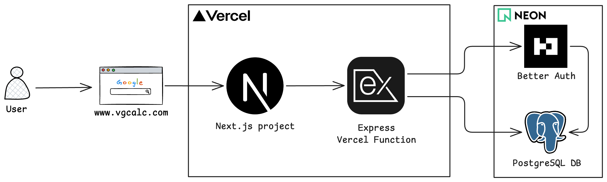

# System architecture — vgc (v1, locked)

Scope: back-end REST API + relational DB first. Next.js frontend later.
Source of truth for data: `docs/relational-model.md`. Background: `reference-reports/`.

## Decisions

1. **Language:** TypeScript everywhere for deployed code (API + future frontend). Node 22+ LTS. Exception: manual one-time init/ETL scripts run locally by the operator and never deployed (e.g. PokeAPI CSV → SQL seed) may use Go.
   The ETL is insert-only (`ON CONFLICT DO NOTHING`): after seeding, the DB is
   the source of truth and re-runs never overwrite curated rows (see
   `relational-model.md` decision 11).
2. **Repo:** Single GitHub repo, plain layout — no Turborepo/Nx.
   `apps/backend/` now, `apps/frontend/` later. `npm` (jobs familiarity).
3. **Frontend (later, reserved):** Next.js on Vercel project #1. Public access.
   Static assets in `public/` + CDN. No object storage (req #10).
4. **Backend:** Express + TS on Vercel project #2 (separate from frontend).
   Whole app = one Vercel Function on Fluid compute. `/api/v1` + OpenAPI
   reserved, contract NOT defined yet. Internal clean-architecture layering
   (routes/controllers/services/repositories) deferred to backend phase.
5. **Database:** Postgres on Neon Free. Single project + branches (10 free;
   PRs test migrations on branch copies). Pooled connection string required
   (serverless concurrency). Frontend never connects to DB directly.
6. **Migrations (Liquibase-style):** Prisma Migrate. Versioned
   `prisma/migrations/*.sql` + `schema.prisma` in git. Local: `migrate dev`
   to generate/review SQL. CI: `migrate deploy` auto-runs on `push to main`
   when `prisma/migrations/**` changes, using `DATABASE_URL` secret.
   DB changes rarely, applied via commit → pipeline.
7. **Auth:** Better Auth, self-hosted, tables in Neon via Prisma adapter.
   v1: public reads (no login), admin-only writes. Login methods deferred.
   No M2M: single backend, browser/Next.js sends user token directly.
   One `SERVICE_API_KEY` env for admin scripts/seed/CI only.
8. **Network / firewall:** CORS open for now; `ALLOWED_ORIGINS` env allowlist
   (frontend URL + manual origins) added when frontend exists. DB protection =
   secret-only (`DATABASE_URL` server-side in backend; Neon Free has no
   IP-allowlist — accepted). Manual Vercel firewall rules if needed.
9. **Local dev:** Docker for Postgres only; API/frontend run natively with
   hot-reload.
10. **CI/CD:** GitHub Actions on `main`: deploy frontend + backend to Vercel,
    `migrate deploy` as path-filtered job. No EKS, no complex pipeline.

## Strict $0 tradeoffs (accepted)

- Vercel Hobby: non-commercial terms, 12-function limit, cold starts,
  250MB single-function bundle, `express.static()` ignored (use `public/`),
  robust error middleware + pooled DB required, stateless only.
- Neon Free: 1GB storage, 100 CU-hours/project/mo, scale-to-zero after
  5min idle (~570ms wake), no IP-allowlist, no backups on free.

## Explicitly deferred

- Backend clean-architecture detail (later phase).
- REST contract: per-entity sections for all DB tables, pagination/error
  envelope, OpenAPI spec (later phase — no code, no endpoint specs now).
- Login methods (email/OAuth/magic-link), curator role (v1 = admin-only).
- `scripts/etl` README / run instructions (ETL itself is done).

## Architecture diagram

